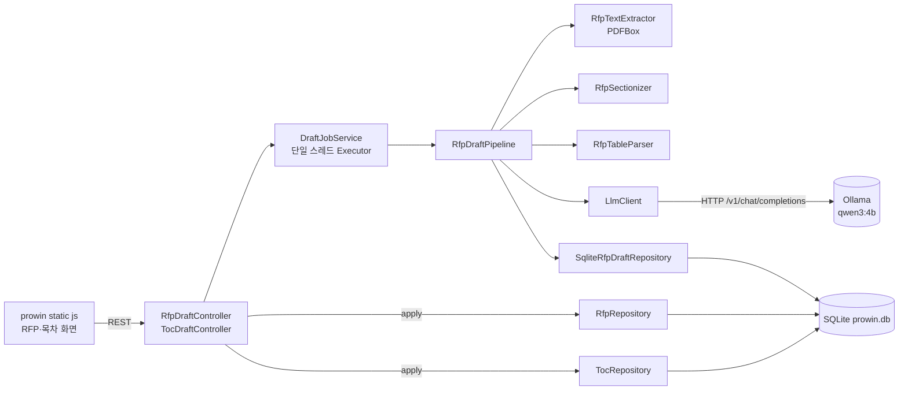
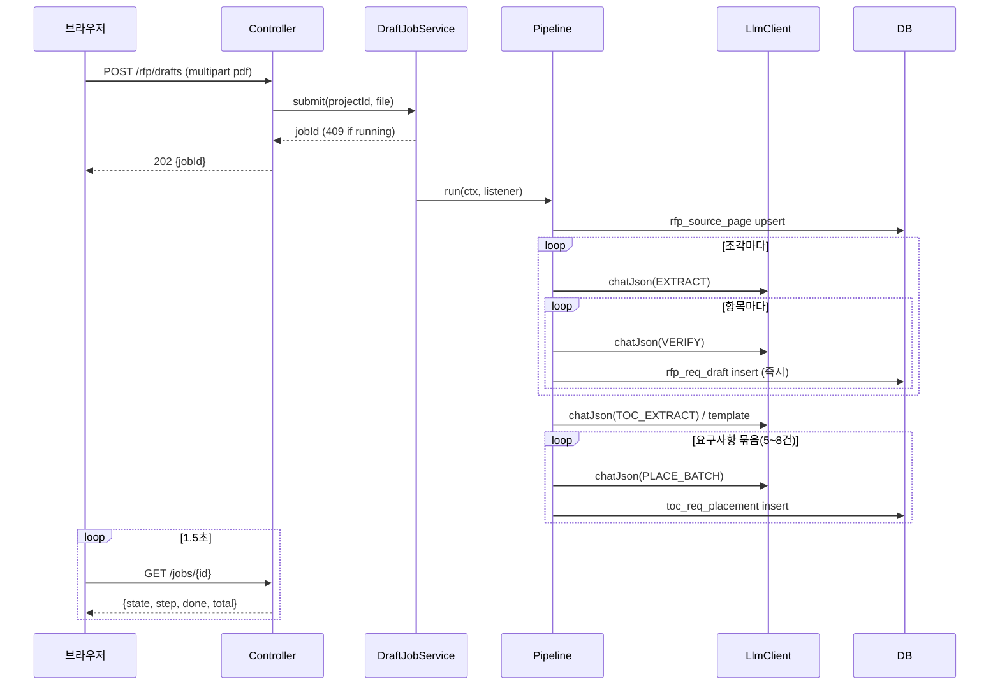
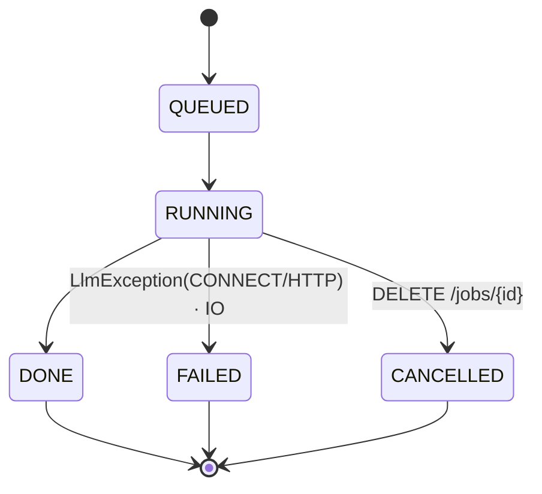
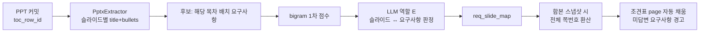

# ProWin RFP 기반 요구사항·목차 초안 자동 생성 — 기술 설계서 (로컬 LLM)

| 항목 | 내용 |
|---|---|
| 대상 시스템 | `ProWin/backend` (Spring Boot 3.3.5, Java 17, SQLite, Apache POI 5.3.0) |
| 참고 구현 | TraceOps 회의록 분석 `traceops-simple/llm.py`, `minutes.py`, `server.py`, `reqdb.py` (커밋 `d3c8a5c`, 장표 `ff81389`) |
| LLM | Ollama(OpenAI 호환 `/v1`) + `qwen3:4b`, CPU 기준. 설정 변경으로 vLLM, llama.cpp 서버 교체 가능 |
| 영향 화면 | RFP / 요구사항, 목차, 조견표, (TODO) 제안서 검토·버전 |

---

## 0. 범위

**포함**
- RFP PDF → 페이지 텍스트 → 구간 분류 → 요구사항 초안(표 파싱 + LLM 추출) → LLM 2차 검증 → 중복·보정
- 목차 초안: RFP 지정 목차 추출 또는 표준 템플릿 → 요구사항 → 세부 목차 배치 → 신규 세부 목차 제안 → 조견표 초안
- 초안 검토·채택 API, 기존 `rfp_requirement`·`toc_row` 반영

**제외 (1차)**
- HWP, 스캔본 PDF(OCR)
- 요구사항 → 제안서 장표(슬라이드) 매핑 → **12장 TODO**에 설계를 남김
- 다중 작업 동시 실행 (동시 1건, TraceOps와 동일)

---

## 1. 아키텍처



### 1.1 처리 시퀀스



### 1.2 패키지 구조

```
com.prowin.llm
  LlmClient                 interface
  OpenAiCompatLlmClient     RestClient 기반 구현
  LlmProperties             @ConfigurationProperties("prowin.llm")
  LlmException              연결·HTTP·형식 오류
  JsonSchemas               스키마 빌더 유틸(Map<String,Object>)
com.prowin.rfpdraft
  ingest/   RfpTextExtractor, PageNormalizer, RfpSectionizer, Chunk, Section
  parse/    RfpTableParser, ReqCodePattern
  stage/    ExtractStage, VerifyStage, DedupStage, TocExtractStage, PlacementStage, PageEstimator
  sim/      Bigram (유사도), Shortlist
  prompt/   Prompts (역할 지시문·스키마 상수, 버전 문자열 포함)
  job/      DraftJobService, DraftJob, JobState, ProgressListener
  api/      RfpDraftController, TocDraftController, dto/*
  repo/     RfpDraftRepository, SqliteRfpDraftRepository
  RfpDraftPipeline
```

---

## 2. 설정

`application.properties` 추가

```properties
prowin.llm.base-url=${LLM_BASE_URL:http://localhost:11434/v1}
prowin.llm.model=${LLM_MODEL:qwen3:4b}
prowin.llm.api-key=${LLM_API_KEY:}
prowin.llm.timeout=${LLM_TIMEOUT:600s}
prowin.llm.no-think=${LLM_NO_THINK:true}
prowin.llm.retries=1

prowin.rfpdraft.chunk-chars=6000
prowin.rfpdraft.verify=true                 # 서술형 추출분 2차 검증
prowin.rfpdraft.verify-table-rows=false     # 표 파싱분은 검증 생략(속도)
prowin.rfpdraft.place-batch-size=6
prowin.rfpdraft.place-shortlist=10
prowin.rfpdraft.fallback-min=12             # minutes.py FALLBACK_MIN
prowin.rfpdraft.fallback-lead=1.3           # minutes.py FALLBACK_LEAD
prowin.rfpdraft.dup-threshold=0.75          # 2-gram 겹침 비율
prowin.rfpdraft.req-code-pattern=(SFR|ECR|PER|INR|DAR|TER|SER|QUR|COR|PMR|PSR)-\\d{3}
prowin.rfpdraft.page-base=1.0
prowin.rfpdraft.page-per-mandatory=0.5
prowin.rfpdraft.page-per-optional=0.2
```

의존성 `pom.xml`

```xml
<dependency>
  <groupId>org.apache.pdfbox</groupId>
  <artifactId>pdfbox</artifactId>
  <version>3.0.3</version>
</dependency>
```
(`RestClient`는 Spring 6.1 기본 포함, JSON은 Jackson 사용 — 추가 의존성 없음)

---

## 3. LLM 클라이언트

### 3.1 인터페이스

```java
public interface LlmClient {
    /** JSON 스키마를 강제해 호출, 파싱·검증된 결과 반환. 실패 시 retries만큼 재요청 후 LlmException. */
    <T> T chatJson(String system, String user, Map<String, Object> schema,
                   Class<T> type, Consumer<T> validator);
    LlmStatus status();   // {ok, baseUrl, model, models[], error}
}
```

테스트에서는 `FakeLlmClient`(지시문 접두어 → 고정 응답 매핑)를 주입. TraceOps `minutes.run(chat=...)` 주입 방식과 동일.

### 3.2 요청 본문

```json
{
  "model": "qwen3:4b",
  "temperature": 0,
  "messages": [
    {"role": "system", "content": "<역할 지시문>\n/no_think"},
    {"role": "user",   "content": "<입력>"}
  ],
  "response_format": {"type": "json_schema", "json_schema": {"name": "result", "schema": { ... }}},
  "reasoning_effort": "none"
}
```
- `reasoning_effort`는 `no-think=true`일 때만 포함(미지원 서버 대비).
- `/no_think` 접미어는 Qwen3 계열 사고 출력 억제용 이중 장치.

### 3.3 응답 처리

```java
String content = resp.choices[0].message.content;
content = content.replaceAll("(?s)<think>.*?</think>", "").strip();   // Qwen3 사고 과정 제거
Matcher m = Pattern.compile("(?s)```(?:json)?\\s*(.*?)```").matcher(content);
if (m.find()) content = m.group(1);                                   // 코드펜스 제거
T out = objectMapper.readValue(content, type);
validator.accept(out);                                                // enum·필수값 검증 → IllegalArgumentException
```

| 오류 | 처리 |
|---|---|
| 연결 실패, 타임아웃 | `LlmException(CONNECT)` 즉시 실패 → 작업 `FAILED`, 메시지 "Ollama 실행 여부 확인" |
| HTTP 4xx/5xx | `LlmException(HTTP)` 본문 앞 300자 포함 |
| JSON 파싱·검증 실패 | `retries`회 재요청 후 `LlmException(FORMAT)` |
| 항목 단위 FORMAT 실패 | 작업은 계속, 해당 조각/항목만 `rfp_draft_error`에 기록하고 화면에 "N건 처리 실패" 표시 |

- `RestClient` 타임아웃: connect 3s, read `prowin.llm.timeout`.
- `status()`: `GET /models` (timeout 3s), 모델 ID 존재 여부, 없으면 `ollama pull <model>` 안내.

---

## 4. 입력 처리 (ingest)

### 4.1 텍스트 추출

```java
try (PDDocument doc = Loader.loadPDF(file.toFile())) {
    PDFTextStripper st = new PDFTextStripper();
    st.setSortByPosition(true);                   // 표 셀 순서 보정
    for (int p = 1; p <= doc.getNumberOfPages(); p++) {
        st.setStartPage(p); st.setEndPage(p);
        pages.add(new Page(p, st.getText(doc)));
    }
}
```
- 텍스트가 페이지당 평균 50자 미만이면 스캔본으로 판단 → 422 `SCANNED_PDF`.

### 4.2 머리말·꼬리말 제거 (`PageNormalizer`)

- 각 페이지 첫 2줄·마지막 2줄을 숫자 제거 후 정규화 → 전체 페이지의 40% 이상에서 반복되면 머리말·꼬리말로 판단해 제거.
- 쪽번호 줄(`^-?\s*\d+\s*-?$`, `^\d+\s*/\s*\d+$`) 제거.
- 하이픈 줄바꿈 결합, 연속 공백 축약.

### 4.3 구간 분류 (`RfpSectionizer`)

1) 제목 줄 탐지 정규식 (우선순위 순)

| 레벨 | 패턴 | 예 |
|---|---|---|
| L1 | `^(제\s*\d+\s*장\|[IVX]+\.)\s+\S+` | `제3장 제안요청 내용`, `III. 기술요건` |
| L2 | `^\d+(\.\d+)?\.?\s+\S+` | `2.1 시스템 구성` |
| L3 | `^[가-하]\.\s+\S+` | `가. 성능 요건` |
| L4 | `^[□■○●▶-]\s*\S+` | `□ 응답시간` |

2) 구간 유형 판정 — 제목·본문 키워드 점수 (코드)

| 유형 | 키워드 | 처리 |
|---|---|---|
| `REQ_TABLE` | 고유번호 패턴 3회 이상 | 표 파싱 |
| `REQ_TEXT` | 요구사항, 요건, 하여야, 제시하여야 | LLM 추출 |
| `TOC_GUIDE` | 제안서 작성 요령, 제안서 목차, 작성 지침, 제안서 구성 | 목차 추출 |
| `EVAL` | 평가 기준, 배점, 평가 항목 | 목차 배치 참고 정보 |
| `OTHER` | 사업 개요, 계약, 입찰, 일반 현황 | 제외(옵션으로 포함) |

점수 동률·0점 구간은 L1 제목만 모아 LLM 1회 호출로 분류(선택 기능, 기본 OFF).

### 4.4 조각 나누기

```text
for section in sections where type == REQ_TEXT:
    buf = []
    for line in section.lines (각 줄 앞에 "[p.N] " 부착):
        if buf.size + len(line) > CHUNK_CHARS and line is heading(L2~L4):  # 제목 경계에서 우선 자름
            emit(buf); buf = []
        elif buf.size + len(line) > CHUNK_CHARS * 1.2:                     # 강제 절단 상한
            emit(buf); buf = [마지막 2줄]                                    # 겹침 2줄
        buf.add(line)
    emit(buf)
```
`Chunk { int index; List<Line> lines; int pageFrom; int pageTo; String headingPath; }` — `headingPath`("III > 2.1 > 가")는 추출 프롬프트에 함께 넣어 문맥 제공.

---

## 5. 요구사항 추출

### 5.1 표 파싱 (`RfpTableParser`) — LLM 미사용

1. `REQ_TABLE` 구간 텍스트를 고유번호 위치로 블록 분할.
2. 블록 안에서 라벨 → 필드 매핑

| 라벨 정규식 | 필드 |
|---|---|
| `요구사항\s*(고유)?번호` | `rfpCode` |
| `요구사항\s*명(칭)?` | `title` |
| `(요구사항\s*)?정의` | `definition` |
| `세부\s*내용` | `detail` |
| `산출\s*정보` / `관련\s*요구사항` | `extra` |

3. `description = definition` (없으면 `detail` 첫 문장), `excerpt = 블록 원문 앞 300자`, `category`는 코드 접두어 매핑(SFR→기능, PER→성능, SER→보안, INR→인터페이스, DAR→데이터, TER→테스트, QUR→품질, PMR→사업관리, PSR→지원, COR→제약, ECR→기능).
4. `strength`는 키워드 사전(5.4)으로 판정.
5. 필수 필드(`rfpCode`, `title`) 누락 블록 → `REQ_TEXT` 조각으로 넘겨 LLM 추출.

### 5.2 LLM 추출 — 역할 A `EXTRACT`

```text
너는 보험사 차세대 시스템 구축 RFP를 분석하는 제안 요구사항 분석가다.
RFP 조각에서 발주처가 제안사에게 요구하는 사항만 뽑는다. 사업 배경, 일반 현황, 계약·입찰 조건은 제외한다.
각 항목:
- page: 근거 문장 줄의 [p.N]에서 N
- excerpt: 근거 원문 그대로 복사(1~3문장, 고쳐 쓰지 말 것)
- rfpCode: RFP에 적힌 요구사항 번호. 없으면 빈 문자열
- title: 20자 이내 요구사항 이름
- description: 무엇을 해야 하는지 한 문장, "~해야 한다" 문체
- category: 기능|성능|보안|인터페이스|데이터|테스트|품질|사업관리|지원|제약
- strength: 필수|권고|선택
요구사항이 없으면 items를 빈 배열로. RFP에 없는 내용을 지어내지 않는다.
```
user: `구간: {headingPath}\nRFP 조각:\n{lines}`

```json
{
  "type": "object",
  "properties": {
    "items": {"type": "array", "items": {
      "type": "object",
      "properties": {
        "page": {"type": "integer"},
        "excerpt": {"type": "string"},
        "rfpCode": {"type": "string"},
        "title": {"type": "string"},
        "description": {"type": "string"},
        "category": {"type": "string", "enum": ["기능","성능","보안","인터페이스","데이터","테스트","품질","사업관리","지원","제약"]},
        "strength": {"type": "string", "enum": ["필수","권고","선택"]}
      },
      "required": ["page","excerpt","rfpCode","title","description","category","strength"]
    }}
  },
  "required": ["items"]
}
```

검증기: `items` 배열, `title`·`description` 공백 아님, enum 값 확인.

후처리 (TraceOps `extract()` 대응)
- `page`가 조각 `pageFrom..pageTo` 밖이면 → 발췌문이 들어 있는 줄의 페이지로 교정, 못 찾으면 `pageFrom`.
- `excerpt`에서 `[p.N]` 접두어 제거. 공백 제거 정규화 후 해당 페이지 텍스트에 없으면 flag `EXCERPT_MISMATCH`.
- `title` 20자 초과 시 절단 + flag 없음(표시만).

### 5.3 2차 검증 — 역할 B `VERIFY`

```text
너는 RFP 요구사항 추출 결과를 검증하는 2차 검토자다. 근거 원문과 앞뒤 문단에 비추어 true/false로 답한다.
- isRequirement: 제안사가 수행·제시·준수해야 하는 사항인가? 배경, 현황, 발주처 자체 업무면 false
- isCompound: 서로 다른 요구가 둘 이상 섞여 있는가?
- strengthMismatch: 원문 표현과 strength가 맞지 않는가?
- note: 판단 근거 원문을 짧게 인용한 한 문장
대화에 없는 내용을 덧붙이지 않는다.
```
user: `추출 요구사항: {title} — {description} ({strength})\n근거: {excerpt}\n\n앞뒤 문단:\n{context}`
`context` = 근거 줄 기준 앞 3줄·뒤 6줄, 최대 1,500자 (`minutes.context()`의 before=1/after=3 발언 단위를 줄 단위로 환산).

스키마: `{isRequirement: boolean, isCompound: boolean, strengthMismatch: boolean, note: string}` 전부 required.

### 5.4 코드 보정 규칙 (결정표)

| 조건 | 결과 |
|---|---|
| `isRequirement=false` | `review_status='excluded_by_ai'` (삭제하지 않음, "AI 제외" 탭) |
| `isCompound=true` | flag `COMPOUND` (자동 분리 안 함) |
| `strengthMismatch=true` | 키워드 사전으로 재판정, 바뀌면 flag `STRENGTH_FIXED` + note에 `필수→권고` 기록 |
| 키워드 사전 | 필수: `하여야`, `해야`, `반드시`, `필수`, `준수` / 권고: `권장`, `바람직`, `권고` / 선택: `가능한 경우`, `선택`, `할 수 있` — 먼저 매칭되는 상위 등급 채택 |
| 검증 호출 FORMAT 실패 | 1차 결과 유지 + flag `VERIFY_FAILED` |

> 근거: TraceOps 실측에서 작은 모델은 "상태를 통째로 다시 고르는" 일에 약해 예/아니오 질문 + 코드 판정이 더 정확했음 (`minutes.py` VERIFY 주석).

### 5.5 중복 처리 (`DedupStage`)

```text
bigram(s) = { s[i:i+2] | 공백 제거한 s }
overlap(a, b) = |A ∩ B| / min(|A|, |B|)

1) rfpCode 같은 항목 → 병합(표 파싱분 우선, LLM분 excerpt는 note에 보존)
2) 같은 category 안에서 overlap(title+description) ≥ dup-threshold → 뒤 항목에 flag DUPLICATE_OF:<id>
```
O(n²)이지만 n ≈ 200 수준이라 문제없음(카테고리 분할로 실제 비교 수 더 적음).

---

## 6. 목차 초안

### 6.1 지정 목차 추출 — 역할 C `TOC_EXTRACT`

입력: `TOC_GUIDE` 구간 전체(6,000자 초과 시 앞에서 자름, 목차 표는 보통 1~3쪽).

```text
너는 RFP의 제안서 작성 지침에서 발주처가 지정한 제안서 목차를 그대로 옮기는 담당자다.
- items[]: level(1|2|3), number(원문 번호 그대로: "I", "1", "1.1", "가"), title(원문 그대로), pageLimit(명시된 장수 제한, 없으면 ""), note(그 항목의 작성 지침 한 문장, 없으면 "")
원문에 없는 항목을 만들지 않는다. 지정 목차가 없으면 items를 빈 배열로.
```

후처리
- `level` 순서 검증(1 다음 3 금지 → 2로 보정), `number` 중복 제거.
- 결과 0건 → 템플릿(`master.json`의 `tocTemplate`, 없으면 내장 기본값) 사용, `origin='template'`.
- 지정 목차는 `origin='rfp_mandated'`, `locked=1`.

내장 기본 템플릿

```
I. 제안 개요        1.1 추진 배경 / 1.2 사업 목표 / 1.3 제안 범위 / 1.4 제안의 특장점
II. 제안 업체 일반   2.1 일반 현황 / 2.2 유사 사업 수행 실적
III. 기술 부문       3.1 목표 시스템 구성 / 3.2 기능 요건 / 3.3 성능 / 3.4 보안 / 3.5 인터페이스 / 3.6 데이터 이관 / 3.7 테스트
IV. 사업관리 부문    4.1 추진 체계·일정 / 4.2 품질관리 / 4.3 위험관리 / 4.4 산출물 관리
V. 지원 부문        5.1 교육 / 5.2 기술 이전 / 5.3 유지보수·하자보수
```

### 6.2 배치 후보 선정 (`Shortlist`)

```text
category → 허용 L1 (규칙표)
  기능·인터페이스·데이터·성능·보안·테스트·제약 → 기술 부문
  사업관리·품질 → 사업관리 부문
  지원 → 지원 부문
L1 매핑 실패(지정 목차 이름이 달라서) → 전체 L2 대상
후보 = 허용 L2/L3 중 bigram 겹침 상위 place-shortlist(10)건
```
지정 목차 L1 이름이 템플릿과 다를 때는 L1 제목 bigram 유사도로 규칙표 키를 대응시킴.

### 6.3 배치 — 역할 D `PLACE_BATCH` (묶음 호출)

```text
너는 RFP 요구사항을 제안서 목차에 배치하는 제안 PM이다.
요구사항마다 아래 목차 후보 중 답변이 들어갈 곳 하나를 고른다.
- reqId: 입력의 요구사항 ID 그대로
- tocId: 후보 ID 그대로. 맞는 곳이 없으면 빈 문자열
- confidence: high|mid|new
- newSectionHint: new일 때 신규 세부 목차 이름(15자 이내), 아니면 ""
- answerPoint: 이 목차에서 답해야 할 핵심 한 문장(작성자 가이드)

목차 후보(ID | 번호 | 제목 | 작성 지침):
{후보 합집합}
```
user: `요구사항:\n{reqId | category | strength | title | description} × 6`

- 묶음 구성: 같은 category·같은 L1끼리 6건씩 → 후보 합집합이 작아짐(보통 10~15건).
- 스키마: `{items: [{reqId, tocId, confidence(enum), newSectionHint, answerPoint}]}`
- 검증기: 입력 reqId 집합과 출력 reqId 집합 일치, 누락 시 FORMAT 오류 → 재요청 → 그래도 누락분은 단건 호출로 재시도.

후처리 (TraceOps `map_decision()` 대응)

| 조건 | 결과 |
|---|---|
| `tocId` 후보에 없음 또는 `confidence=new` | `fallback`: bigram 1위 점수 ≥ `fallback-min` 이고 2위의 `fallback-lead`배 이상 → 그 목차, `mid`, `fixed_by_rule=1` |
| fallback도 실패 | 미배치 → 6.4 |
| `newSectionHint`가 ID 모양(`^[A-Z]{2,}[-_]`) | 버리고 `title` 앞 15자 사용 |

### 6.4 신규 세부 목차 제안

- 미배치 요구사항을 category별로 묶어 1회 호출: "이 요구사항들을 담을 세부 목차 이름과 소속 L1을 제안" → `{sections: [{l1Id, title, reqIds[]}]}`.
- 생성 항목 `origin='ai_new'`, 지정 목차 아래라도 맨 뒤에 추가(기존 번호 불변).

### 6.5 예상 장수 (`PageEstimator`, 코드)

```
est = page-base + Σ(필수 × page-per-mandatory) + Σ(권고·선택 × page-per-optional)
est = ceil(est)
if pageLimit 있음: est = min(est, pageLimit), 초과 시 flag OVER_LIMIT
```

### 6.6 조견표 초안

`toc/drafts/apply` 시 `toc_req_placement` + 반영된 `rfp_requirement`로 생성.

| 필드(`matrix.json` 기준) | 값 |
|---|---|
| `rfp` | 요구사항 `page` |
| `big`/`mid`/`small` | 요구사항이 속한 RFP `headingPath` |
| `d1` | 요구사항 description |
| `ok` | 기본 `수용` (PM 수정) |
| `toc` | 배치된 목차 번호·제목 |
| `page` | 빈 값 → **12장 TODO(장표 매핑)에서 채움** |

---

## 7. 작업(Job) 모델

### 7.1 상태



```java
public record DraftJob(String id, String projectId, JobState state, String step,
                       int done, int total, int itemsSaved, int itemErrors,
                       String error, Instant startedAt, Instant finishedAt) {}
```

- `ExecutorService = Executors.newSingleThreadExecutor()`; 실행 중 작업이 있으면 새 요청은 `409 JOB_RUNNING` (TraceOps `server.py`는 동시 1건).
- 작업 상태는 메모리 `ConcurrentHashMap` + 종료 시 `rfp_draft_job` 테이블 기록(서버 재시작 후 이력 조회용).
- 취소: `AtomicBoolean cancelled`를 단계 경계(조각·항목 사이)에서 확인. 진행 중 HTTP 요청은 끝까지 기다림.
- 진행률 `total` = 조각 수 + 배치 묶음 수 (단계 전환 시 재계산).

### 7.2 재분석

- 같은 프로젝트에 재실행 시 `review_status='draft'` 및 `excluded_by_ai`만 삭제 후 재생성, `accepted`/`rejected`는 유지.
- 재생성 항목이 유지 항목과 `rfpCode` 같거나 overlap ≥ 0.9 → 새 항목 버림(중복 방지).
- 초안 ID: `AI-{n}` 프로젝트별 증가(삭제돼도 재사용 안 함, `reqdb.py` 방식).

### 7.3 트랜잭션

- 항목 저장: 건당 auto-commit (즉시 화면 표시 목적).
- `apply`: 단일 트랜잭션 — `rfp_requirement` insert + `rfp_req_draft.applied_req_id` update + 변경 이력. 실패 시 전체 롤백.
- SQLite `hikari.maximum-pool-size=1`이므로 장시간 작업 중 읽기 API와 커넥션 경합 주의 → LLM 호출 동안 커넥션을 잡지 않도록 저장 시점에만 `JdbcTemplate` 사용.

---

## 8. 데이터베이스 (`schema.sql` 추가)

```sql
CREATE TABLE IF NOT EXISTS rfp_source_page (
  project_id TEXT NOT NULL,
  page       INTEGER NOT NULL,
  text       TEXT NOT NULL,
  section    TEXT NOT NULL DEFAULT 'OTHER',   -- REQ_TABLE|REQ_TEXT|TOC_GUIDE|EVAL|OTHER
  heading    TEXT NOT NULL DEFAULT '',
  PRIMARY KEY (project_id, page)
);

CREATE TABLE IF NOT EXISTS rfp_req_draft (
  id                TEXT PRIMARY KEY,            -- AI-n
  project_id        TEXT NOT NULL,
  job_id            TEXT NOT NULL,
  page              INTEGER,
  heading_path      TEXT NOT NULL DEFAULT '',
  excerpt           TEXT NOT NULL DEFAULT '',
  rfp_code          TEXT NOT NULL DEFAULT '',
  title             TEXT NOT NULL,
  description       TEXT NOT NULL DEFAULT '',
  category          TEXT NOT NULL,
  strength          TEXT NOT NULL CHECK (strength IN ('필수','권고','선택')),
  source            TEXT NOT NULL CHECK (source IN ('table','llm')),
  flags             TEXT NOT NULL DEFAULT '[]',  -- JSON: EXCERPT_MISMATCH, COMPOUND, STRENGTH_FIXED, DUPLICATE_OF:<id>, VERIFY_FAILED
  verification_note TEXT NOT NULL DEFAULT '',
  review_status     TEXT NOT NULL DEFAULT 'draft'
                    CHECK (review_status IN ('draft','accepted','rejected','excluded_by_ai')),
  edited_json       TEXT,                        -- 사람이 고친 필드
  reviewed_by       TEXT, reviewed_at TEXT,
  applied_req_id    TEXT REFERENCES rfp_requirement(id),
  prompt_version    TEXT NOT NULL DEFAULT '',
  created_at        TEXT NOT NULL
);
CREATE INDEX IF NOT EXISTS ix_rdraft_proj ON rfp_req_draft(project_id, review_status);
CREATE INDEX IF NOT EXISTS ix_rdraft_code ON rfp_req_draft(project_id, rfp_code);

CREATE TABLE IF NOT EXISTS toc_draft (
  id            TEXT PRIMARY KEY,                -- TD-n
  project_id    TEXT NOT NULL,
  parent_id     TEXT REFERENCES toc_draft(id),
  level         INTEGER NOT NULL,
  number        TEXT NOT NULL DEFAULT '',
  title         TEXT NOT NULL,
  origin        TEXT NOT NULL CHECK (origin IN ('rfp_mandated','template','ai_new','manual')),
  locked        INTEGER NOT NULL DEFAULT 0,
  page_limit    TEXT NOT NULL DEFAULT '',
  est_pages     INTEGER,
  guide_note    TEXT NOT NULL DEFAULT '',
  order_index   INTEGER NOT NULL,
  review_status TEXT NOT NULL DEFAULT 'draft',
  applied_toc_id TEXT REFERENCES toc_row(id)
);

CREATE TABLE IF NOT EXISTS toc_req_placement (
  toc_draft_id  TEXT NOT NULL REFERENCES toc_draft(id) ON DELETE CASCADE,
  req_draft_id  TEXT NOT NULL REFERENCES rfp_req_draft(id) ON DELETE CASCADE,
  confidence    TEXT NOT NULL CHECK (confidence IN ('high','mid','new','manual')),
  answer_point  TEXT NOT NULL DEFAULT '',
  fixed_by_rule INTEGER NOT NULL DEFAULT 0,
  PRIMARY KEY (req_draft_id)                     -- 요구사항당 주 배치 1곳
);

CREATE TABLE IF NOT EXISTS rfp_draft_job (
  id TEXT PRIMARY KEY, project_id TEXT NOT NULL, state TEXT NOT NULL,
  file_name TEXT, pages INTEGER, items_saved INTEGER, item_errors INTEGER,
  error TEXT, started_at TEXT, finished_at TEXT, model TEXT, prompt_version TEXT
);

CREATE TABLE IF NOT EXISTS rfp_draft_error (
  id INTEGER PRIMARY KEY AUTOINCREMENT, job_id TEXT NOT NULL,
  stage TEXT NOT NULL, ref TEXT, message TEXT NOT NULL, created_at TEXT NOT NULL
);
```

`apply` 매핑: `rfp_requirement.code = rfp_code` (빈 값이면 `R-nn` 채번), `title`, `description = description + "\n[근거 p.N] " + excerpt`.

---

## 9. API 명세

| 메서드 | 경로 | 요청 | 응답 |
|---|---|---|---|
| GET | `/api/llm/status` | – | `{ok, baseUrl, model, models[], error?}` |
| POST | `/api/projects/{pid}/rfp/drafts` | multipart `file`(pdf), `who` | `202 {jobId}` / `409 JOB_RUNNING` / `422 SCANNED_PDF\|NOT_PDF` |
| GET | `/api/jobs/{jobId}` | – | `DraftJob` |
| DELETE | `/api/jobs/{jobId}` | – | `204` (취소 요청) |
| GET | `/api/projects/{pid}/rfp/drafts?status=draft` | – | `{items: ReqDraft[], counts: {draft, accepted, rejected, excluded_by_ai}}` |
| GET | `/api/projects/{pid}/rfp/pages/{page}` | – | `{page, text, heading}` (원문 보기) |
| PUT | `/api/projects/{pid}/rfp/drafts/{id}` | `{reviewStatus?, edit?: {title, description, category, strength, rfpCode}, who}` | `ReqDraft` |
| POST | `/api/projects/{pid}/rfp/drafts/apply` | `{ids?: [], who}` (없으면 accepted 전체) | `{applied: n, requirementIds: []}` |
| GET | `/api/projects/{pid}/toc/drafts` | – | `{rows: TocDraft[], placements: Placement[], unplaced: []}` |
| PUT | `/api/projects/{pid}/toc/drafts/{id}` | `{title?, orderIndex?, parentId?, who}` (locked면 title·number 변경 `423 LOCKED`) | `TocDraft` |
| PUT | `/api/projects/{pid}/toc/placements/{reqDraftId}` | `{tocDraftId}` (드래그 이동, confidence→manual) | `Placement` |
| POST | `/api/projects/{pid}/toc/drafts/apply` | `{who}` | `{tocRows: n, matrixRows: n}` |

`ReqDraft` 예시

```json
{
  "id": "AI-014", "page": 57, "headingPath": "III > 2.4 > 가",
  "rfpCode": "PER-003", "title": "조회 응답시간 보장",
  "description": "가입설계 조회 화면은 3초 이내에 응답해야 한다.",
  "category": "성능", "strength": "필수", "source": "table",
  "excerpt": "모든 조회 화면은 3초 이내 응답하여야 하며 ...",
  "flags": ["COMPOUND"], "verificationNote": "2차 검증: 조회 응답과 배치 목표가 함께 있음",
  "reviewStatus": "draft"
}
```

오류 응답은 기존 `GlobalExceptionHandler`/`ApiException` 형식을 따른다.

---

## 10. 화면 연동

- 진입 시 `GET /api/llm/status` → 배지: "로컬 LLM 연결됨 (qwen3:4b)" / "LLM 미기동 · 시연 모드".
- 시연 모드: 업로드 시 서버 분석 대신 저장된 초안(`data/rfp_draft_demo.json`)을 단계별 타이머로 재생 (TraceOps `requirements-review.js` 방식).
- 폴링: 1.5초 `GET /jobs/{id}` + `itemsSaved`가 늘면 `GET /rfp/drafts?since=<lastId>`로 증분 조회.
- 목록 필터: 상태, category, strength, flag. 키보드 `A`(채택)/`R`(제외)/`E`(수정).
- 목차 초안: 좌측 트리(locked 자물쇠, `AI` 배지, `OVER_LIMIT` 경고), 우측 배치 목록 드래그 → `PUT /toc/placements/{id}`.

---

## 11. 테스트·품질 측정

### 11.1 단위·통합 테스트 (JUnit 5)

| 클래스 | 검증 내용 |
|---|---|
| `PageNormalizerTest` | 반복 머리말·꼬리말·쪽번호 제거 |
| `RfpSectionizerTest` | 제목 레벨 탐지, 구간 유형 점수, 6,000자·제목 경계 분할, 겹침 2줄 |
| `RfpTableParserTest` | 라벨 순서 뒤섞임, 셀 줄바꿈, 코드 누락 블록 → REQ_TEXT 이관 |
| `OpenAiCompatLlmClientTest` | MockWebServer: `<think>` 제거, 코드펜스, FORMAT 재요청 1회, 연결 실패 예외 |
| `VerifyStageTest` | 결정표 5.4 전 분기 |
| `DedupStageTest` | 코드 병합, overlap 임계치 경계값 |
| `PlacementStageTest` | 묶음 응답 reqId 누락 → 재요청 → 단건 재시도, fallback 규칙 경계(12점, 1.3배) |
| `RfpDraftPipelineTest` | `FakeLlmClient`로 PDF 샘플 전 과정, 재분석 시 accepted 유지 |
| `DraftJobServiceTest` | 409 동시 실행 차단, 취소, FAILED 전이 |

### 11.2 품질 지표 (실 RFP 1건, 사람이 만든 목록을 정답으로)

```
재현율   = |AI 초안 ∩ 정답| / |정답|          (매칭: rfpCode 일치 또는 overlap ≥ 0.6 + 같은 page±1)
정밀도   = |AI 초안 ∩ 정답| / |AI 초안(excluded 제외)|
배치 일치율 = 정답 목차와 같은 L2에 배치된 비율
```
목표(1차): 재현율 ≥ 0.90, 정밀도 ≥ 0.80, 배치 일치율 ≥ 0.70. 측정 스크립트 `tools/eval_rfp_draft.py`(JSON 비교).

### 11.3 프롬프트 버전 관리

- `Prompts.VERSION = "rfp-2026.11.1"`을 초안·작업 레코드에 저장 → 지시문 변경 전후 지표 비교.

---

## 12. TODO — 요구사항 → 제안서 장표 매핑

> 목차 확정 후 작성자가 세부 목차 단위로 PPT를 올리면(`proposal_commit.toc_row_id`), 그 목차에 배치된 요구사항이 **실제 어느 슬라이드에서 답변됐는지** 매핑해 조견표 `page`를 채우고 누락을 잡는다.

### 12.1 기존 자산
- `PptxExtractor.extract(Path)` → `List<SlideContent(title, bullets)>` (이미 커밋 시 검토 노드 채우기에 사용)
- `proposal_commit(toc_row_id, slide_count, is_snapshot)`, 합본 스냅샷 `PptxMerger`
- 6장 산출물: 목차별 배치 요구사항(`toc_req_placement` → `rfp_requirement`)

### 12.2 설계 초안



- 트리거: `POST /versions/commits` 성공 후 비동기(같은 `DraftJobService` 큐).
- 역할 E `SLIDE_MAP`: 입력 = 슬라이드 목록(`index | title | bullets 앞 300자`) + 요구사항 목록(이 목차 배치분) → `{items: [{reqId, slideIndexes[], coverage: full|partial|none, note}]}`.
- 저장:
  ```sql
  CREATE TABLE IF NOT EXISTS req_slide_map (
    req_id       TEXT NOT NULL REFERENCES rfp_requirement(id),
    commit_hash  TEXT NOT NULL REFERENCES proposal_commit(commit_hash),
    slide_index  INTEGER NOT NULL,              -- 커밋 내 0-base
    coverage     TEXT NOT NULL CHECK (coverage IN ('full','partial')),
    source       TEXT NOT NULL CHECK (source IN ('llm','rule','manual')),
    note         TEXT NOT NULL DEFAULT '',
    PRIMARY KEY (req_id, commit_hash, slide_index)
  );
  ```
- 쪽번호 환산: 합본 스냅샷 생성 시 목차 순서대로 `offset = Σ 앞 목차 최신 커밋 slide_count`, `page = offset + slide_index + 1 + 표지·목차 장수` → 조견표 `page`.
- 커밋이 새로 올라오면 해당 `toc_row_id`의 매핑만 재계산, `manual` 매핑은 유지.

### 12.3 체크리스트

- [ ] `PptxExtractor` 확장: 표(`XSLFTable`) 셀 텍스트, 그룹 도형 내부 텍스트, 슬라이드 노트 포함
- [ ] 역할 E 지시문·스키마 확정 (한 커밋 슬라이드 30장 초과 시 10장 단위 분할 호출)
- [ ] `req_slide_map` 스키마·Repository·커밋 후 비동기 트리거
- [ ] 합본 스냅샷 시 쪽번호 환산 → `matrix` page 자동 반영(조견표 백엔드 이전 선행)
- [ ] 제안서 검토 화면: 슬라이드 옆 "이 장표가 답하는 요구사항" 칩, 목차별 "미답변 요구사항 N건" 경고
- [ ] 필수 요구사항 미답변 → 제안서 홈 "지연 항목"에 노출
- [ ] 수동 매핑 UI(요구사항 칩 드래그 → 슬라이드), `source='manual'`
- [ ] 품질 지표: 사람이 만든 조견표 page와 일치율

### 12.4 그 외 TODO

- [ ] HWP 입력: `hwp5txt`/LibreOffice 변환 후 PDF 파이프라인 재사용
- [ ] 스캔본 OCR(Tesseract kor) 옵션
- [ ] 평가 항목·배점(`EVAL` 구간) → 목차별 장수 가중치
- [ ] 유사사례 RAG(`docs/1117/ProWin_개선계획.md`) 결합: 세부 목차별 과거 제안서 페이지 추천, `answerPoint` 보강
- [ ] 수주 후 확정 요구사항 → TraceOps `requirements` 내보내기(`source`에 RFP 코드·페이지 기록)
- [ ] GPU 서버(vLLM) 전환 시 묶음 크기·조각 크기 상향 프로파일

---

## 13. 성능 예산

TraceOps 실측 (i7-1360P, RAM 16GB, `qwen3:4b`, CPU, no-think): 추출 조각당 25~60초, 검증 건당 15~35초, 매칭 건당 ≤ 60초.

```
T ≈ N_chunk × 45s  +  N_text_req × 25s  +  ceil(N_table_req / 5) × 40s  +  ceil(N_req / 6) × 90s  +  N_cat × 60s
     (추출)           (서술형 검증)        (표 제목·분류 정리)             (배치 묶음)                (신규 목차)
```

218쪽 RFP 가정(**실측 전 추정**): 서술형 조각 15, 서술형 요구 60, 표 요구 120, 전체 180, 미배치 카테고리 4

| 단계 | 계산 | 시간 |
|---|---|---|
| 추출 | 15 × 45s | ~11분 |
| 검증 | 60 × 25s | ~25분 |
| 표 정리 | 24 × 40s | ~16분 |
| 배치 | 30 × 90s | ~45분 |
| 신규 목차 | 4 × 60s | ~4분 |
| 합계 | | **~1시간 40분** |

단축 수단: 검증 묶음화(3~5건/호출), 표 정리 생략 옵션(코드 접두어 분류만), GPU 서버 전환(`base-url` 변경만). 결과가 생기는 대로 화면에 표시되므로 검토는 분석과 동시에 시작 가능.

---

## 14. 일정

| 주차 | 작업 | 완료 기준 |
|---|---|---|
| 1주 | Python 실험 스크립트(`llm.py` 재사용)로 역할 A~D 지시문·스키마 확정, 샘플 RFP 실측 | 11.2 지표 1차 측정, 13장 실측치로 갱신 |
| 2주 | `llm` 패키지, ingest(PDFBox·정규화·구간·조각), 표 파서, 추출·검증·중복, DB, 요구사항 API | `RfpDraftPipelineTest` 통과, 샘플 PDF로 초안 생성 |
| 3주 | 목차 추출·템플릿·후보·묶음 배치·fallback·신규 목차·장수·조견표 초안, 목차 API | 목차 초안 → `toc_row` 반영 |
| 4주 | 화면(진행·검토·드래그·시연 모드), 실 RFP 검증, 성과 장표 | 지표 목표 달성 또는 차이 원인 정리 |
| 이후 | 12장 장표 매핑 TODO | – |

---

## 15. 위험

| 위험 | 영향 | 대응 |
|---|---|---|
| PDF 표가 텍스트로 풀리며 셀 순서 뒤섞임 | 표 파싱 실패 | `setSortByPosition`, 라벨 기반 파싱, 실패 블록은 LLM 추출로 이관 |
| 작은 모델의 복합 요구·강도 판단 오류 | 정밀도 저하 | 예/아니오 질문 + 코드 결정표, 자동 분리 금지 |
| 묶음 배치에서 reqId 누락·혼동 | 배치 누락 | 집합 검증 → 재요청 → 단건 재시도 |
| 지정 목차 변형 | 평가 감점 | `locked`, API 레벨 `423 LOCKED` |
| SQLite 단일 커넥션 경합 | 화면 지연 | LLM 호출 중 커넥션 미점유, 저장만 짧게 |
| 장시간 작업 중 서버 재시작 | 작업 유실 | 저장된 초안은 유지, 작업은 FAILED 기록 후 재분석(검토분 보존) |
| 결정 필요: 요구사항 코드 체계 | 조견표·TraceOps 연계 | 제안: RFP 코드를 `code`로, 내부 ID 별도 |
| 결정 필요: 조견표 백엔드 이전 | 12장 TODO 선행 조건 | 목차 확정 기능과 함께 이전 권장 |
