# 기능 개발 문서

범위: `traceops-simple`은 연계관리(연계 캔버스) 기능만, `ProWin`은 전체 화면 + 그중 실제 백엔드(Spring Boot)에 연결된 부분을 다룬다.

---

## 1. 개발환경

### 1.1 아키텍처 구성도

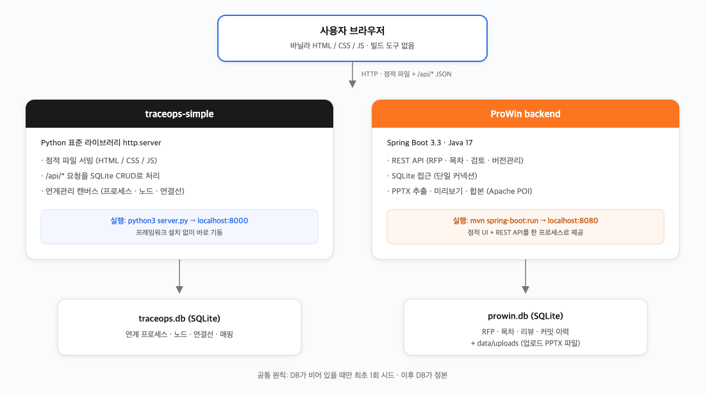

### 1.2 간단한 설명

- **공통 철학**: 두 프로젝트 다 "빌드 단계 없는 프론트(바닐라 JS, CDN 폰트만 사용) + 가벼운 백엔드 1개 프로세스 + 파일 기반 SQLite" 구조다. npm/webpack 같은 빌드 도구가 없어서 코드를 고치면 새로고침만 하면 바로 반영된다.
- **traceops-simple**: 백엔드가 Python 표준 라이브러리만으로 짜여 있어 별도 프레임워크 설치가 필요 없다(`python3 server.py`로 바로 실행). SQLite 파일(`traceops.db`) 하나가 데이터 저장소다.
- **ProWin backend**: Spring Boot 기반 REST API 서버. SQLite로 데이터를 다루고, 제안서 PPTX 업로드·슬라이드 이미지 추출·여러 PPTX 합본은 Apache POI로 처리한다. `mvn spring-boot:run` 또는 빌드된 jar로 실행하며 기본 포트는 8080.
- **데이터 시드**: 둘 다 "DB가 비어 있으면 최초 1회만 시드를 넣고, 그 다음부터는 DB가 정본"이라는 규칙을 따른다.

---

## 2. traceops-simple — 연계관리(연계 캔버스)

### 2.1 기능 설명

업무 흐름을 캔버스에 노드·연결선으로 그려서 관리하는 화면. 두 축으로 구성된다.

- **AS-IS 프로세스**: 지금 실제로 동작하는 업무 흐름. 미리 준비된 데이터로 취급하며 화면에서 새로 만들거나 고치지 않는다(조회 전용).
- **TO-BE 프로세스**: 새로 설계하는 업무 흐름. 추상적인 큰 그림(자유 노드)부터, 실제 설계·개발 항목을 참조하는 구체적인 캔버스까지 "하위 캔버스"로 계속 파고들 수 있다.

노드 하나는: 이름, 짧은 설명(메모), 성격(서비스/인터페이스-대외계/인터페이스-채널계), 그리고(항목 기반 캔버스라면) 실제 개발 항목 참조 + 개발 완료 여부를 가진다. 연결선은 동기/비동기를 표시할 수 있다(비동기면 점선 + "비동기" 라벨).

### 2.2 구현 방식

- 프로세스(캔버스) · 노드 · 연결선 · AS-IS 매핑을 SQLite에 저장한다. 프로세스는 AS-IS/TO-BE, 자유 입력/개발항목 참조, 업무 카테고리로 구분한다.
- 목록·캔버스 조회와 저장은 REST API로 처리한다.
- 개발항목 기반 캔버스는 저장 시 실제 개발 항목을 참조해야 하고, 같은 캔버스에서 같은 항목을 중복 참조할 수 없다. 참조한 항목이 나중에 지워지면 막지 않고 "삭제됨"만 표시한다.
- 목록은 AS-IS/TO-BE 그룹으로 나뉘고 접기·검색·카테고리 필터를 지원한다. 캔버스에서는 노드를 드래그해 옮기고, 개발 목록을 끌어다 바로 노드를 만든다. 연결선은 노드 경계에서 각도에 따라 자연스럽게 퍼지도록 그린다.
- AS-IS 캔버스와 작업자 모드는 조회만 가능하다.

### 2.3 대략적인 프로세스

1. 목록 화면에서 TO-BE 프로세스를 하나 고른다(또는 "+ TO-BE 프로세스"로 새로 만든다 — 이때 이 캔버스의 노드가 자유 텍스트인지 개발항목 참조인지 고른다).
2. 캔버스에 들어가 노드를 그리거나(자유 캔버스) 오른쪽 개발 목록을 드래그해 항목을 채운다(항목 기반 캔버스).
3. 노드끼리 오른쪽 동그란 핸들을 드래그해 연결선을 만들고, 필요하면 클릭해서 동기↔비동기를 토글한다.
4. 더 쪼개야 하는 노드는 "하위 캔버스 만들기"로 들어가 같은 방식으로 더 구체화한다.
5. "저장"을 눌러 DB에 반영한다. AS-IS 쪽은 이 전체 과정이 막혀 있고 조회만 가능하다.

서버: `cd traceops-simple && python3 server.py` → `http://localhost:8000/linkage.html`

**목록 화면** — AS-IS/TO-BE 그룹, 검색·카테고리 필터

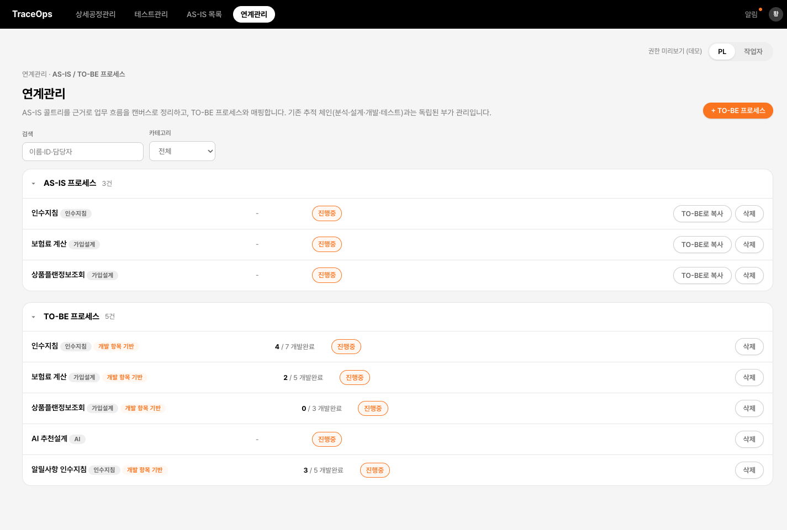

**TO-BE 캔버스** — 인수지침. 병렬 분기와 하위 캔버스 진입

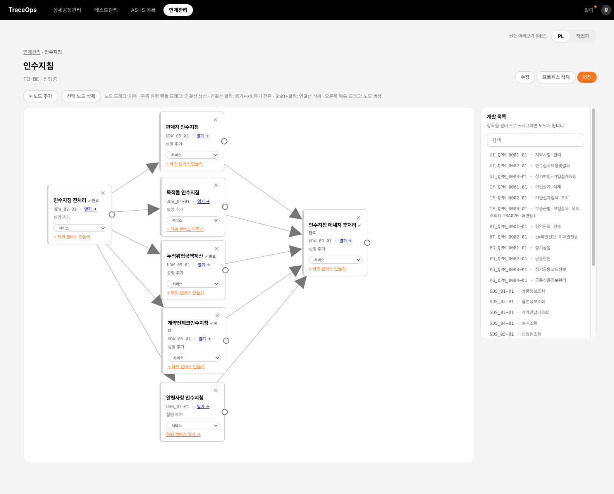

**하위 캔버스** — 알릴사항 인수지침. 한 단계 더 구체화된 흐름

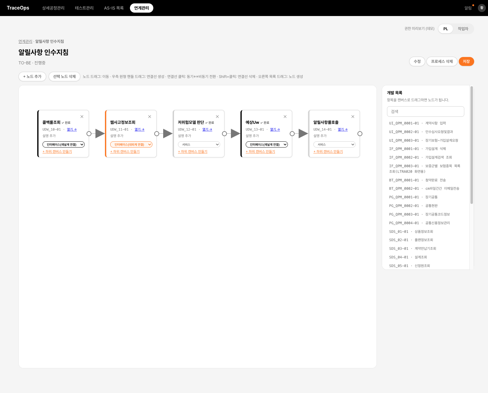

**AS-IS 조회 전용** — 노드 추가·저장·수정 버튼이 없고 조회만 가능

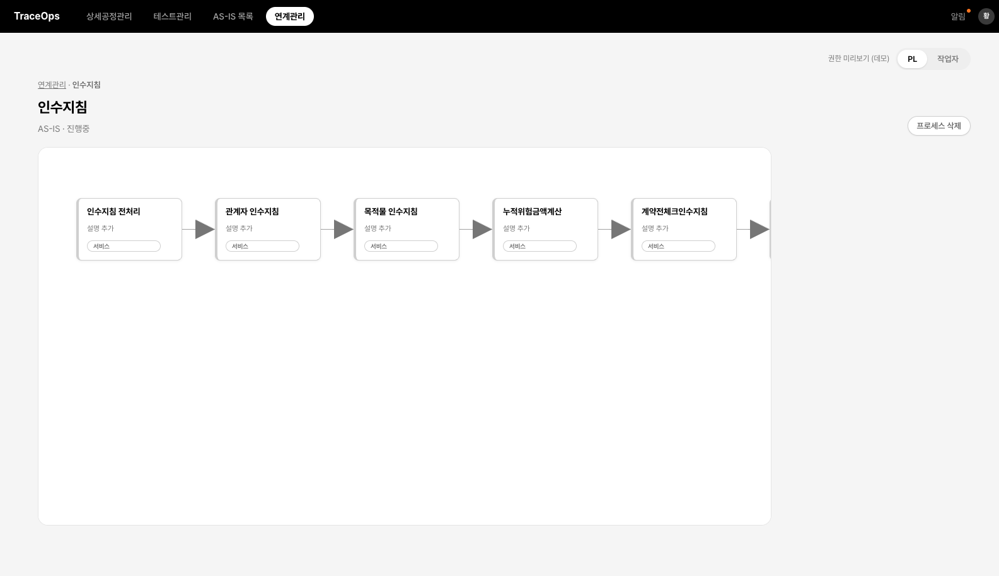

---

## 3. ProWin — 전체 기능 + 백엔드 연결 부분

ProWin은 "한화손해보험 장기 차세대 가입설계" RFP 대응을 위한 제안팀 협업 도구다. 로그인 후 좌측 메뉴는 3그룹(전역 / 제안 워크스페이스 / ProWin 관리)으로 나뉘며, 역할(작성자/PM·사업관리/영업대표/시스템관리자)에 따라 보이는 화면과 편집 권한이 다르다.

**서버 기동**: `cd ProWin/backend && ./mvnw spring-boot:run` → `http://localhost:8080` (최초 로그인: id `201803176` / pw `0000`, 시스템관리자 권한으로 전체 화면 접근 가능)

### 3.1 전체 화면 목록

| 그룹 | 화면 | 설명 | 백엔드 연결 |
|---|---|---|---|
| 전역 | 제안 현황 | 기간별 제안 진행 현황 목록 | ✗ (JSON) |
| 전역 | 자산 라이브러리 | 과거 제안서 페이지 단위 적재/검색 | ✗ (JSON) |
| 워크스페이스 | 제안서 홈 | 제안 개요 + 오늘 할 일(일정 연동) + 지연 항목 | ✗ (JSON) |
| 워크스페이스 | 커뮤니케이션 | 제안팀 공지·공유 게시판 | ✗ (JSON) |
| 워크스페이스 | 제안 일정 | 짧은 일정(2~3주) 등록/수정, 색상 구분 | ✗ (JSON) |
| 워크스페이스 | **RFP / 요구사항** | RFP 문서 정보 + 요구사항 목록 관리 | **✓ Spring Boot** |
| 워크스페이스 | 자유 게시판(워크스페이스 관리에서 추가) | 제안 전용 자유 게시판 | ✗ (JSON) |
| 워크스페이스 | **목차** | 제안서 전체 목차 = 진척 마스터(담당·상태·예상장수) | **✓ Spring Boot** |
| 워크스페이스 | **제안서 검토** | 슬라이드 보기·설명회 지정·리뷰 코멘트 | **✓ Spring Boot** |
| 워크스페이스 | **제안서 관리(버전)** | PPT 업로드=커밋, 합본=스냅샷 | **✓ Spring Boot** |
| 워크스페이스 | 조견표 | 최종 취합본 기준 요구사항↔목차 매핑 | ✗ (JSON) |
| 워크스페이스 | 워크스페이스 관리 | 자유 게시판 추가/수정/삭제 | ✗ (JSON) |
| 워크스페이스 | 제안 권한관리 | 제안 단위 멤버·권한 관리 | ✗ (JSON) |
| 워크스페이스 | 제안 경비 관리 | 자사/외주 인건비·디자인·인쇄비 | ✗ (JSON) |
| 워크스페이스 | 수행 공수 관리 | 투입 M/M·직급별 공수 | ✗ (JSON) |
| 관리 | 시스템 접근 권한관리 | 프로젝트에 종속되지 않는 시스템 마스터 권한 | ✗ (JSON) |
| 관리 | 사용 가이드 | 사이트 사용법 통합 가이드 | ✗ (JSON) |
| 관리 | 변경 이력 | 추가·수정·삭제 이력(감사 대응) | ✗ (JSON) |

JSON으로 표시된 화면은 `data/*.json`을 최초 로드하고, 편집분은 브라우저에서 들고 있다가 "저장" 시 변경 확인 후 내보내기(파일 교체)로 반영하는 구조다. 아래부터는 실제 Spring Boot 백엔드에 연결된 4개 화면을 자세히 다룬다.

**제안서 홈** — 워크스페이스 진입 첫 화면

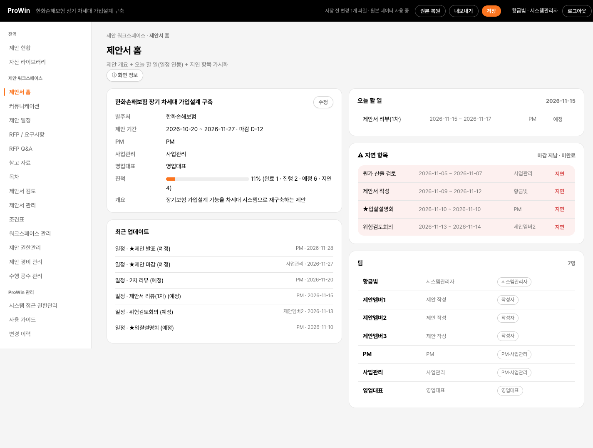

**좌측 메뉴** — 전역 / 제안 워크스페이스 / ProWin 관리 3그룹

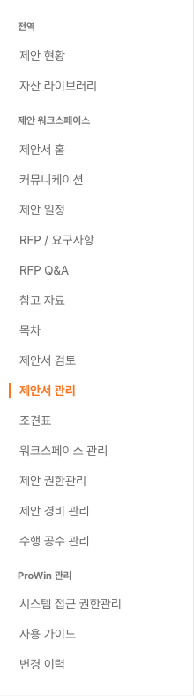

### 3.2 RFP / 요구사항 관리 (백엔드 연결)

**기능 설명**: RFP 문서 1건(파일명/페이지수/수령일) + 요구사항 목록(코드/제목/설명)을 관리한다. 요구사항은 생성·수정·삭제(삭제 시 사유 기록)가 가능하다.

**구현 방식**
- 프로젝트당 RFP 문서 1건과 요구사항 목록을 DB에 저장한다. 삭제는 사유를 남기는 소프트 삭제다.
- 화면은 REST API로 조회·등록·수정·삭제한다.

**대략적인 프로세스**: RFP 수신 → 문서 정보 등록 → 요구사항을 하나씩 코드/제목/설명으로 등록 → (뒤의 "조견표" 화면에서 이 요구사항이 목차의 어느 페이지에서 충족되는지 매핑).

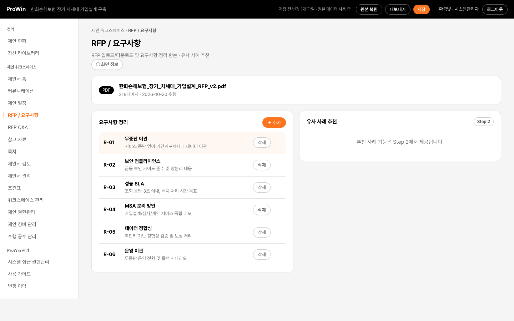

### 3.3 목차 관리 (백엔드 연결)

**기능 설명**: 제안서 전체 목차를 레벨(대/세부)·담당자·예상 장수·상태로 관리한다. 이 목차가 뒤의 검토·버전관리 화면 전체의 기준(마스터)이 된다.

**구현 방식**
- 대/세부 레벨, 담당자, 예상 장수, 상태를 DB에서 관리한다. 삭제는 소프트 삭제다.
- 세부 목차가 이후 검토·PPT 업로드의 단위가 된다.

**대략적인 프로세스**: RFP 요구사항을 바탕으로 목차 뼈대를 만든다 → 세부 목차(레벨 2)마다 담당자를 지정한다 → 작성이 진행되며 상태(진행중/완료 등)와 예상 장수를 갱신한다 → 세부 목차는 "제안서 관리" 화면에서 PPT를 업로드할 단위가 된다.

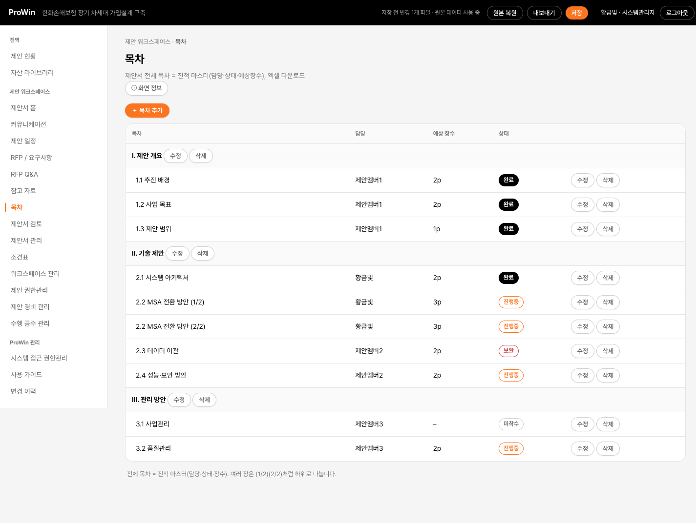

### 3.4 제안서 검토 (백엔드 연결)

**기능 설명**: 목차의 세부 항목(레벨 2)마다 "검토 노드"(메모, 슬라이드 제목, 흐름 단계, 핵심 불릿) + 댓글 스레드 + "설명회 발표자료 지정" 여부를 관리한다. 회의록을 대체하는 용도.

**구현 방식**
- 세부 목차마다 검토 내용과 댓글 스레드를 둔다.
- "제안서 관리"에서 PPT를 업로드하면 슬라이드 제목·핵심 내용이 검토 노드에 자동으로 채워진다.

**대략적인 프로세스**: 세부 목차 담당자가 초안을 PPT로 업로드 → 자동으로 슬라이드 제목·핵심내용이 검토 노드에 채워짐 → 리뷰어가 코멘트를 남김 → 최종 발표에 쓸 슬라이드를 "설명회 발표자료"로 지정.

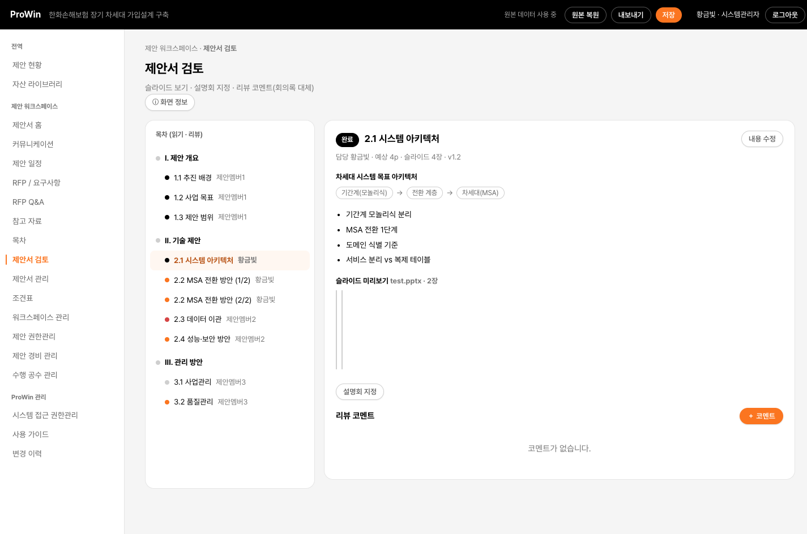

### 3.5 제안서 관리 — 버전관리 (백엔드 연결, 가장 복잡한 모듈)

**기능 설명**: 세부 목차 단위로 PPT를 업로드하면 "커밋"이 되고(버전 이력), 전체 세부 목차의 최신 업로드를 목차 순서대로 **자동 병합(합본)** 해서 하나의 PPTX로 만든다. 슬라이드 미리보기 이미지, 원본 다운로드도 제공한다.

**구현 방식**
- 업로드된 PPT는 커밋 이력으로 쌓이고, 실제 파일은 디스크에 두며 DB에는 경로와 메타만 기록한다.
- Apache POI로 슬라이드 텍스트 추출, 미리보기 이미지 렌더링, 목차 순서 합본을 처리한다.
- 합본은 불변 스냅샷으로 남고 다운로드할 수 있다.

**대략적인 프로세스**: 담당자가 자기 섹션 PPT를 업로드(=커밋) → 자동으로 슬라이드 내용이 검토 화면에 반영되고 장수가 갱신됨 → 여러 섹션이 업로드되면 PM/사업관리가 "합본"을 눌러 전체 목차 순서대로 하나의 PPTX로 병합 → 합본 파일을 다운로드해 실제 제출/발표에 사용.

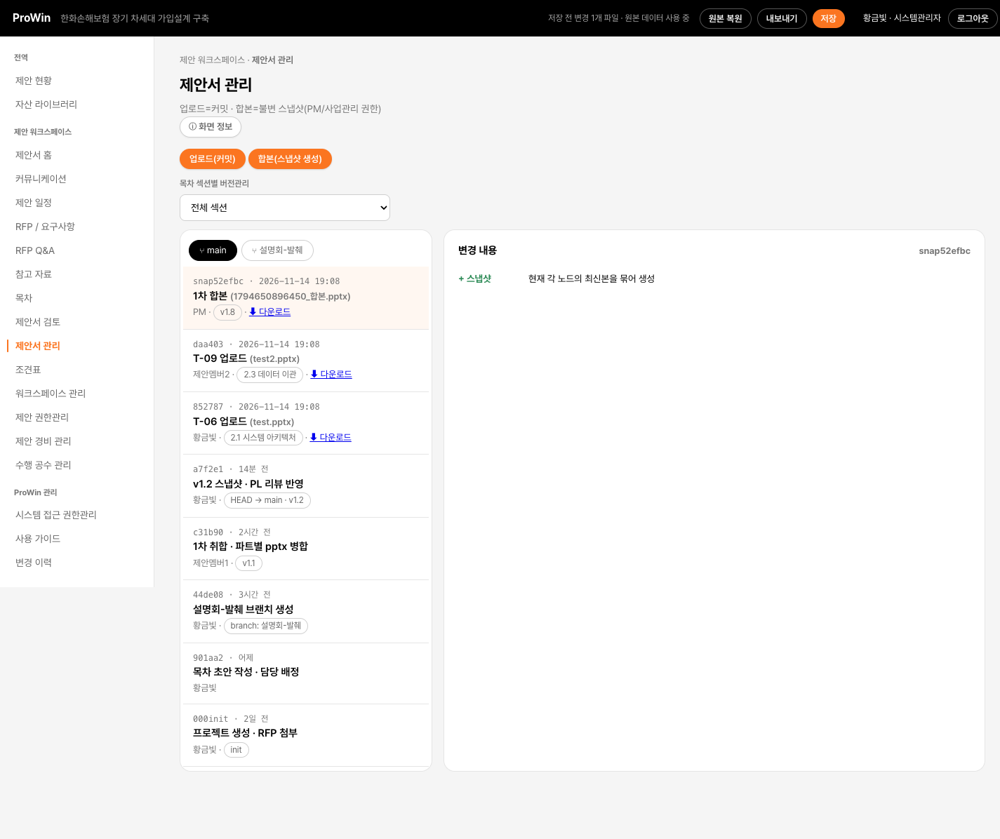

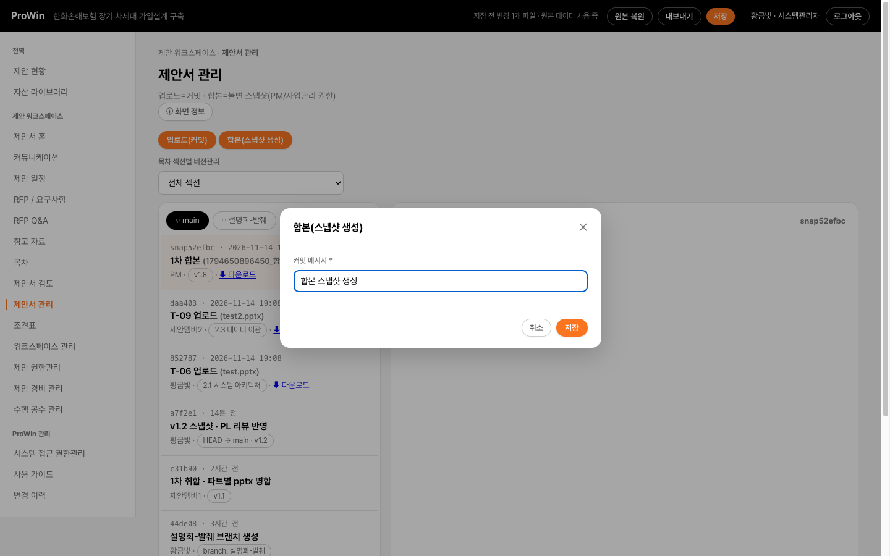

---

## 4. 참고

- 두 프로젝트 모두 삭제는 가능한 한 **소프트 삭제** 또는 **참조 중이면 차단**하는 방식을 쓴다 — 실제 운영 데이터를 실수로 완전히 날리지 않도록.
- 두 프로젝트 모두 "DB 우선, JSON은 최초 시드 전용"이라는 같은 원칙을 쓴다. `data/*.json` 파일은 최초 실행 시에만 읽히고, 그 뒤로는 DB가 정본이다.
