# 요구사항·추적 관리 ERD

SQLite(`traceops.db`) 스키마. 정의는 `reqdb.py`의 `SCHEMA`, 검증은 `python3 test_reqdb.py`.
GitHub·VS Code(Mermaid 지원)에서 아래 다이어그램이 그림으로 보입니다.

```mermaid
erDiagram
  requirements ||--o{ req_stakeholders : "담당자 (삭제 시 함께 삭제)"
  requirements |o--o{ decisions : "req_id (삭제·변경 제한)"
  requirements ||..o{ requirement_history : "req_id (FK 없음 · 이력 보존)"
  meetings ||--o{ decisions : "meeting_file"
  decisions ||--o| decision_reviews : "검토 결과"
  decisions ||--o{ review_history : "검토 이력"
  analysis_items ||--o{ analysis_requirements : "분석 → 요구사항"
  requirements ||--o{ analysis_requirements : "요구사항ID (삭제 제한)"
  design_items ||--o{ design_analysis : "설계 → 분석"
  analysis_items ||--o{ design_analysis : "분석ID (삭제 제한)"
  dev_items ||--o{ dev_design : "개발 → 설계"
  design_items ||--o{ dev_design : "설계ID (삭제 제한)"
  design_items ||--o{ design_physical : "설계 → 물리ID"
  physical_ids ||--o{ design_physical : "물리ID (사용 중 삭제 제한)"
  dev_items ||--o{ dev_physical_add : "개발 추가 물리ID"
  physical_ids ||--o{ dev_physical_add : "물리ID"
  unit_items ||--o{ unit_dev : "단위 → 개발"
  dev_items ||--o{ unit_dev : "개발항목 (삭제 제한)"
  integration_items ||--o{ integration_units : "통합 → 묶인 단위"
  unit_items ||--o{ integration_units : "단위테스트 (삭제 제한)"

  requirements {
    TEXT id PK "RQ_QPM_0001"
    TEXT major
    TEXT middle
    TEXT minor
    TEXT name
    TEXT content "요구사항내역"
    TEXT stage "분석 | 설계"
    TEXT status "수용 | 조건부수용 | 부분수용 | 미수용"
    TEXT kind "기능 | 비기능"
    TEXT precondition
    TEXT source
    TEXT created_at
    TEXT updated_at
  }
  req_stakeholders {
    TEXT req_id PK, FK
    TEXT role PK "vendor | cust_it | cust_biz"
    TEXT owner
    TEXT team
  }
  requirement_history {
    INTEGER id PK
    TEXT req_id "요구사항ID (FK 없음)"
    TEXT ts
    TEXT who
    TEXT action "create | update | delete"
    TEXT field
    TEXT old_value
    TEXT new_value
    TEXT meeting_file "근거 회의록"
    TEXT decision_id "근거 결정사항"
    TEXT note
  }
  meetings {
    TEXT file PK "1-27.txt"
    TEXT label
    TEXT duration
  }
  decisions {
    TEXT id PK "D1"
    TEXT meeting_file FK
    TEXT req_id FK "nullable"
    TEXT meeting_text
    TEXT excerpt_ts
    TEXT excerpt
    TEXT decision
    TEXT raw_status
    TEXT final_status "ok | review | open"
    TEXT verification_note
    TEXT confidence
    TEXT addition
    TEXT replace_with
    TEXT new_req_hint
  }
  decision_reviews {
    TEXT decision_id PK, FK
    INTEGER reviewed
    TEXT status
    TEXT confirmed_by
    TEXT confirmed_at
    TEXT edited_text
  }
  review_history {
    INTEGER id PK
    TEXT decision_id FK
    TEXT ts
    TEXT who
    TEXT what
  }
  analysis_items {
    TEXT id PK "UI_QPM_0001"
    TEXT src_id
    TEXT type
    TEXT name
    TEXT worker
    TEXT schedule_cols "작업·공정 계획/실적 일자 8개"
    TEXT evidence "JSON"
    TEXT remarks "JSON"
    TEXT extra "JSON"
  }
  design_items {
    TEXT id PK
    TEXT src_id
    TEXT type
    TEXT name
    TEXT worker
    TEXT dev_type
    TEXT dev_round
    TEXT schedule_cols "일자 8개"
    TEXT evidence "JSON"
    TEXT remarks "JSON"
  }
  dev_items {
    TEXT id PK "UI_QPM_0001-01"
    TEXT src_id
    TEXT src_name
    TEXT type
    TEXT name
    TEXT worker
    TEXT difficulty
    TEXT priority
    TEXT description
    TEXT link_basis
    TEXT schedule_cols "일자 8개"
    TEXT evidence "JSON"
    TEXT remarks "JSON"
  }
  analysis_requirements {
    TEXT analysis_id PK, FK
    TEXT req_id PK, FK
  }
  design_analysis {
    TEXT design_id PK, FK
    TEXT analysis_id PK, FK
  }
  dev_design {
    TEXT dev_id PK, FK
    TEXT design_id PK, FK
  }
  physical_ids {
    TEXT id PK "LTRA010.html"
    TEXT type "화면 | 인터페이스 | 프로그램 ..."
    TEXT name
    TEXT group_name
    TEXT related_screen
    TEXT status
    TEXT remark
  }
  design_physical {
    TEXT design_id PK, FK
    TEXT phys_id PK, FK
  }
  dev_physical_add {
    TEXT dev_id PK, FK
    TEXT phys_id PK, FK
  }
  unit_items {
    TEXT id PK "UI_QPM_0001-01-01"
    TEXT src_id
    TEXT name
    TEXT expected
    TEXT round
    TEXT worker
    TEXT exec_date
    TEXT result "PASS | FAIL"
    TEXT evidence "JSON"
    TEXT remarks "JSON"
  }
  integration_items {
    TEXT id PK "IT-0001"
    TEXT src_id
    TEXT name
    TEXT expected
    TEXT round
    TEXT worker
    TEXT exec_date
    TEXT result
    TEXT evidence "JSON"
    TEXT remarks "JSON"
  }
  unit_dev {
    TEXT unit_id PK, FK
    TEXT dev_id PK, FK
  }
  integration_units {
    TEXT integration_id PK, FK
    TEXT unit_id PK, FK
  }
```

## 테이블 역할

| 테이블 | 역할 | 건수(시드) |
|---|---|---|
| `requirements` | 요구사항 본문. 단계·수용여부·구분은 CHECK 제약 | 77 |
| `req_stakeholders` | 업체 / 고객IT / 고객업무 담당자·담당팀 (요구사항당 3행) | 231 |
| `requirement_history` | 필드별 변경 이력. 근거 회의록·결정사항을 함께 기록 | 0 (저장 시 누적) |
| `meetings` | 회의록 목록 | 12 |
| `decisions` | 회의록에서 추출한 결정사항, 관련 요구사항ID 연결 | 8 |
| `decision_reviews` | PL의 확정·반려·보류 결과 (결정사항당 최대 1행) | 0 |
| `review_history` | 검토 처리 이력 | 0 |
| `analysis_items` | 분석 단계 항목 (현황업무분석) | 13 |
| `design_items` | 설계 단계 항목 (화면·DB·프로그램·인터페이스 설계) | 13 |
| `dev_items` | 개발 단계 항목 | 12 |
| `analysis_requirements` | 분석 ↔ 요구사항 연결. 요구사항은 분석 단계에서 정함 | 16 |
| `design_analysis` | 설계 ↔ 분석 연결 | 13 |
| `dev_design` | 개발 ↔ 설계 연결 | 12 |
| `design_requirements` (뷰) | 설계의 요구사항 = 연결된 분석의 요구사항 (계산) | 16 |
| `dev_requirements` (뷰) | 개발의 요구사항 = 연결된 설계의 요구사항 (계산) | 14 |
| `physical_ids` | 물리ID 마스터 (화면·인터페이스·프로그램 등 AS-IS 목록) | 13 |
| `design_physical` | 설계 ↔ 물리ID 연결 | 13 |
| `dev_physical_add` | 개발이 설계 것 외에 추가로 갖는 물리ID | 0 |
| `dev_physical` (뷰) | 개발의 물리ID = 설계의 물리ID + 추가분 (계산) | 12 |
| `unit_items` | 단위테스트 케이스와 수행 결과 | 21 |
| `unit_dev` | 단위테스트 ↔ 개발 연결 (단위 1건당 개발 1건) | 21 |
| `unit_requirements` (뷰) | 단위의 요구사항 = 연결된 개발의 요구사항 (계산) | 29 |
| `unit_physical` (뷰) | 단위의 물리ID = 연결된 개발의 물리ID (계산) | 21 |
| `integration_items` | 통합테스트 케이스와 수행 결과 | 4 |
| `integration_units` | 통합 ↔ 묶인 단위테스트 연결 (단위 일부를 선택) | 21 |
| `integration_dev` (뷰) | 통합에 관련된 개발항목 = 묶인 단위들의 개발항목 합집합 (계산) | 12 |
| `integration_requirements` (뷰) | 통합의 요구사항ID = 묶인 단위들의 합집합 (계산) | 14 |
| `integration_physical` (뷰) | 통합의 물리ID = 묶인 단위들의 합집합 (계산) | 12 |

## 관계 규칙

- **추적 체인**: 요구사항 ← 분석 ← 설계 ← 개발 ← 단위테스트 ← 통합테스트. 위 단계가 참조 중이면 아래 단계 항목과 요구사항은 삭제·변경할 수 없습니다(FK).
- **상속되는 값은 저장하지 않고 계산**합니다. 설계·개발·단위의 요구사항ID와 물리ID, 통합의 개발ID·요구사항ID·물리ID가 모두 해당합니다. 위 단계를 바꾸면 아래에 자동 반영되어 값이 어긋나지 않습니다. 계산은 `reqdb.py`의 `_derive()`가 하고, 같은 결과를 SQL로 조회할 수 있게 뷰로도 제공합니다.
- **통합테스트**는 묶인 단위테스트(`integration_units`)만 저장하고, 연관 개발항목·요구사항ID·물리ID는 단위들의 합집합입니다.
- **물리ID**는 마스터(`physical_ids`)가 있어 설계·개발이 사용 중인 물리ID는 삭제할 수 없습니다.
- **요구사항 변경 이력**(`requirement_history`)은 FK가 없어 요구사항을 삭제해도 남습니다. 회의 결정사항으로 반영된 변경은 근거 회의록·결정사항ID가 함께 기록됩니다.
- **증적·비고**는 JSON 컬럼입니다. 별도 엔티티로 다루게 되면 테이블로 분리합니다.
